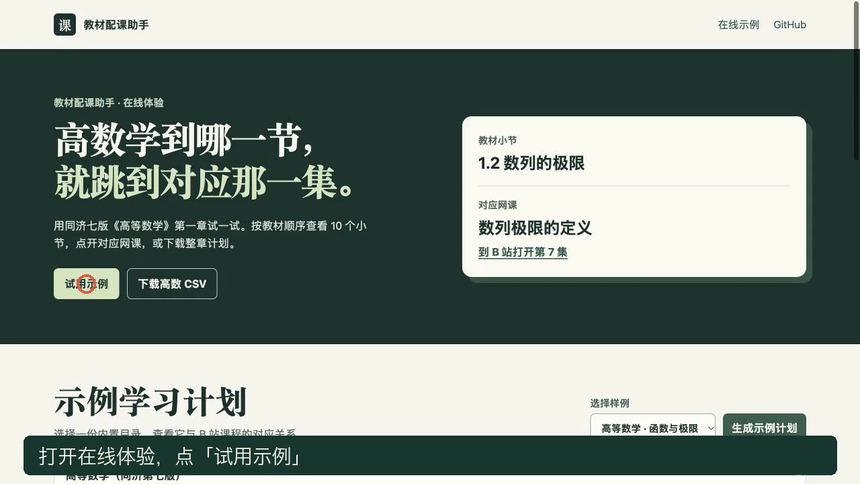

# 教材配课助手

**高数学到哪一节，就跳到 B 站对应的那一集。** 上传 PDF 或粘贴教材目录，生成逐节对应、可导出 CSV 的网课计划。

[在线体验](https://yanzirui666.github.io/textbook-course-matcher/) · [下载高数示例计划 CSV](https://yanzirui666.github.io/textbook-course-matcher/functions-and-limits.csv) · [提议适配一本教材](https://github.com/yanzirui666/textbook-course-matcher/issues/new?title=%E6%95%99%E6%9D%90%E9%85%8D%E8%AF%BE%E5%8F%8D%E9%A6%88)

[](https://yanzirui666.github.io/textbook-course-matcher/)

## 同济七版《高等数学》第一章 · 函数与极限

按教材的 10 个小节排列。标有集数的链接会直接打开对应分集，在线体验还提供数据结构和世界近代史的样例。

<!-- showcase:table:start -->

| 教材小节 | 对应网课 |
| --- | --- |
| 1.1 映射与函数 | [第 1 集 · 1.1 映射](https://www.bilibili.com/video/BV1Eb411u7Fw/?p=1) |
| 1.2 数列的极限 | [第 7 集 · 1.2 数列极限的定义](https://www.bilibili.com/video/BV1Eb411u7Fw/?p=7) |
| 1.3 函数的极限 | [第 10 集 · 1.3 函数极限](https://www.bilibili.com/video/BV1Eb411u7Fw/?p=10) |
| 1.4 无穷小与无穷大 | [第 11 集 · 1.4 无穷小与无穷大](https://www.bilibili.com/video/BV1Eb411u7Fw/?p=11) |
| 1.5 极限运算法则 | [第 12 集 · 1.5 极限运算准则（修后）](https://www.bilibili.com/video/BV1Eb411u7Fw/?p=12) |
| 1.6 极限存在准则 两个重要极限 | [第 13 集 · 1.6 极限存在准则 两个重要极限](https://www.bilibili.com/video/BV1Eb411u7Fw/?p=13) |
| 1.7 无穷小的比较 | [第 14 集 · 1.7 无穷小的比较](https://www.bilibili.com/video/BV1Eb411u7Fw/?p=14) |
| 1.8 函数的连续性与间断点 | [第 15 集 · 1.8 函数的连续性与间断点](https://www.bilibili.com/video/BV1Eb411u7Fw/?p=15) |
| 1.9 连续函数的运算与初等函数的连续性 | [高数入门 · 连续函数运算与初等函数连续性](https://www.bilibili.com/video/BV1kg411h7Lf/) |
| 1.10 闭区间上连续函数的性质 | [第 17 集 · 1.10 闭区间连续函数的性质](https://www.bilibili.com/video/BV1Eb411u7Fw/?p=17) |

<!-- showcase:table:end -->

目录顺序参考[高等教育出版社的第七版配套辅导书](https://xuanshu.hep.com.cn/front/h5Mobile/bookDetails?bookId=59cf765fba9eb884cf8230a0)，分集位置以 [B 站选集](https://www.bilibili.com/list/ml2772390947?bvid=BV1Eb411u7Fw&oid=48624233)为准。

## 本地运行

用 [uv](https://docs.astral.sh/uv/getting-started/installation/) 管理 Python 3.12 和依赖。在源码目录执行：

```bash
uv run --locked --no-dev streamlit run app.py
```

浏览器会打开本地网页，默认地址是 `http://127.0.0.1:8501`。选择「试用示例」，可以直接用高等数学、数据结构或历史的默认目录生成计划。选择「粘贴目录」或「上传 PDF」即可换成自己的材料。

### 整理自己的目录

每行放一个标题，支持常见的中文章、节编号和 `1.1` 式编号。也可以每级缩进两个空格来明确层级：

```text
第一章 函数与极限
  1.2 数列的极限
  1.3 函数的极限
第二章 导数
  2.1 导数的定义
```

PDF 上限 20 MB。优先读取书签，没有可用书签时从前 30 页提取目录文字。若遇到扫描件、加密文件或提取结果不全，可直接修改可编辑目录或粘贴文本。填写书名、版次或科目有助于区分同名章节。生成的 CSV 使用带 BOM 的 UTF-8，便于用 Excel 打开。

### 联网查找更多资源

从 [Brave Search](https://api-dashboard.search.brave.com/app/keys) 获得 API 密钥，将它设置为启动进程的环境变量 `BRAVE_SEARCH_API_KEY`。可以用终端的隐藏输入读取密钥：

```bash
# Bash 或 Zsh
printf 'Brave Search API key: '
IFS= read -rs BRAVE_SEARCH_API_KEY
printf '\n'
export BRAVE_SEARCH_API_KEY
uv run --locked --no-dev streamlit run app.py
```

```powershell
# PowerShell 7.2+
$env:BRAVE_SEARCH_API_KEY = Read-Host "Brave Search API key" -MaskInput
uv run --locked --no-dev streamlit run app.py
```

启动网页后勾选「联网查找更多 B 站视频」，再生成计划。每个不同的小节查询最多请求一次 Brave Search，连续使用时会在当前页面会话中复用已完成的查询。超时或限流时，计划表保留已取得的结果和内置索引匹配，可以稍后再次生成。

教材 PDF 在本机内存中处理。勾选联网选项后，发给 Brave Search 的仅有根据确认后的书名、科目、章节标题生成的查询。程序使用 Brave 已索引的 B 站视频页面，检索范围取决于其索引。联网推荐依据标题、摘要和章节上下文，视频能否播放及内容细节以原页为准。

## 开发与贡献

```bash
uv run --locked pytest -q
```

`app.py` 提供网页入口，`course_matcher/` 包含目录解析、检索、匹配和 CSV 导出。内置索引位于 `course_matcher/data/catalog.json`。贡献视频时，请提供原视频页链接，核对主题、对应的分集编号及分集标题。请注明教材、版次、章和小节。更新索引后，运行 `uv run --locked python scripts/build_showcase.py` 同步示例表和体验页数据。

项目代码采用 [MIT 许可证](LICENSE)。课程链接指向 B 站原页面，视频内容的权利归相应权利人。
